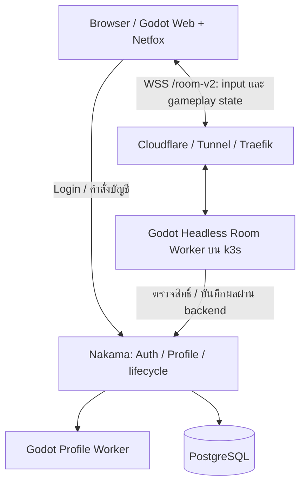

# สรุปปัญหาออนไลน์หน่วงและการย้ายไป Netfox

วันที่สรุป: 28 ตุลาคม 2026 (Asia/Bangkok)  
สถานะล่าสุด: Boss ทดลองแล้วแจ้งว่า **“ลื่นขึ้นมากเลย”** หลัง deploy Web `288ff8cb2bbc` + Rooms `netfox-20261028-4`.

เอกสารนี้เป็นจุดอ่านสถานะล่าสุดของงานแก้ netcode รอบนี้ ส่วน ADR0019 เก็บเหตุผลทางสถาปัตยกรรมและประวัติระหว่างพัฒนา ซึ่งบางย่อหน้าเป็นสถานะเก่าตามเวลาที่บันทึก ไม่ใช่สถานะปัจจุบัน

## 1. ผลที่ได้ และขอบเขตที่ยังต้องแยกให้ชัด

- ผู้ใช้ยืนยันว่าการเล่นตอบสนองและลื่นขึ้นมากแล้ว เป็นหลักฐานจากการเล่นจริง ไม่ใช่ผลห้องจำลอง
- Web จริงหลังแพตช์ clock มีเลข tick ของ client/reference ต่างกัน1tick รับ input ได้1,188ครั้ง และไม่มี `future_window` ในรายงานนั้น
- สาเหตุที่พิสูจน์ทำซ้ำได้คือ clock หลัง pause คลาดถาวร และมีงาน replay ช่วงเดิมซ้ำทั้งที่ยังไม่มี authoritative state ใหม่
- ลานฝึกที่เข้าแล้วกดอะไรไม่ได้มีบั๊กวงจรห้องแยกอีกตัว: ไม่มีมอนจึงถูกตัดสินว่าชนะและจบตั้งแต่ tick1
- ยังไม่ได้เปลี่ยน URL ปกติให้ใช้ Netfox โดยปริยาย และยังไม่ได้ลบระบบเดิมออกทั้งหมด
- ไม่ได้พิสูจน์ว่าความหน่วงทุกชนิดหายแล้ว หรือ Cloudflare ไม่มีผลใด ๆ การทดสอบออนไลน์หลายคน การเซฟ/เข้าใหม่ และกรณีเน็ตแกว่งยังต้องเก็บหลักฐานต่อ

## 2. อาการตั้งต้นที่ผู้ใช้ต้องการแก้

หลังเพิ่ม server-authoritative gameplay ผู้ใช้พบกดแล้วหน่วง เดินถูกดึงกลับ มอนกระตุก/ถอยย้อน เห็นมอนอยู่ใกล้แต่ตีวืด และบางรอบใช้สกิลแล้วค้าง อาการเกิดทั้งผ่านอินเทอร์เน็ตและระหว่างลองเส้น LAN

เกณฑ์สำคัญของผู้ใช้คือ **ความตรงและความทันทีของการควบคุม/ตำแหน่ง** ไม่ใช่เพียงค่า FPS เฉลี่ย ผู้ใช้ย้ำว่า30FPSยังเล่นได้ แต่อาการดึงขาและคำสั่งไม่ตรงเวลาทำให้เล่นไม่ได้

ระบบเดิมมีโค้ดเฉพาะของเราในการคุม input tick/lead, prediction, snapshot, history, reconcile/replay และ remote interpolation หลายส่วน การแก้ทีละอาการช่วยบางกรณี แต่ไม่ทำให้โครงสร้างทั้งหมดถูกต้องโดยอัตโนมัติ

## 3. เส้นทางการตรวจ และข้อสรุปที่ใช้ได้จริง

### Local และ A/B/C

- โหมด local ที่ไม่ต่อ Room WSS เล่นดีขึ้นชัดเจน แต่การตัดทั้ง WSS และ authoritative state/reconciliation ออกพร้อมกันยังแยกไม่ได้ว่าเป็นตัว transport หรือการนำ state มาใช้
- โหมด B รับข้อมูลจากห้องจริงแต่ทิ้ง state แล้วจำลอง local; โหมด C ปิด socket และใช้ local simulation เดิม จึงไม่ใช่เกมออนไลน์ที่ยืนยันตำแหน่งร่วมกับเพื่อนได้ครบ
- หลายรอบ A ที่ apply authoritative state ดึงขาชัดกว่า B/C หลักฐานจึงชี้ให้ตรวจการรับ/apply/reconcile state และ clock มากกว่าสรุปจาก FPS
- ห้อง synthetic `perf-lab` ใช้หา cost ของบางชั้นได้ แต่แทนห้องจริงที่มี input/AI/สกิล/เหตุการณ์ตอบกลับครบไม่ได้ ผู้ใช้ทักท้วงถูกต้อง การยืนยันรอบหลังจึงต้องเป็น Web + Room จริง
- การลอง bypass Cloudflare ผ่าน LAN ไม่ได้ทำให้อาการหายทั้งหมด จึงไม่มีหลักฐานพอจะสรุปว่า Tunnel เป็นสาเหตุหลัก และไม่ควรรีบเปลี่ยน WSS เป็น SSE เพื่อแก้ปัญหานี้

### ปัญหาย่อยที่พบระหว่างทาง

- เคยมี WebSocket close1009 และปัญหา encode/frame ที่ทำให้ reconnect ซ้ำและผู้เล่นไม่เดิน รายงานที่ `valid:false`, ACKไม่เดิน หรือกำลัง reconnect ใช้สรุปคุณภาพการเล่นปกติไม่ได้
- การเอา server authoritative correction ออกทำให้อาการหาย ไม่ได้แปลว่าใช้โหมดนั้นเป็นออนไลน์จริงได้ ต้องรักษา authority และแสดงตำแหน่งที่ทุกคนอ้างอิงร่วมกัน
- การเทียบ snapshot/history ต้องจับคู่ tick และ ACK ให้ถูก แยก hit/สถานะที่ server เพิ่มออกจาก desync ที่ไม่คาดไว้ การทำ smooth อย่างเดียวไม่แก้เหตุที่ state ต่างกัน
- Ping ที่วัดในแอปมีเวลารอ poll/worker/main thread ปนอยู่ ไม่ใช่ pure network RTT โดยอัตโนมัติ ไม่มี disconnect ก็ยังหน่วงจากคิวหรือ application scheduling ได้

รายละเอียดตัวเลขดั้งเดิมอยู่ในรายงานผู้ใช้, `docs/tech/input_trace_20261028_TH.md`, เอกสาร lag report และบันทึก ADR0019; ไม่สร้างตัวเลขที่ไม่มีหลักฐานย้อนหลังเพิ่ม

## 4. เปลี่ยนอะไรเมื่อย้ายมา Netfox

ใช้ Netfox1.35.3 ที่ pin commit `c7fc6ea52b4e9087c980d9ca1f8c3826e3a6caa4` พร้อม license เดิม ต้นฉบับเก็บไว้ที่ `tools/netcode/vendor/netfox-1.35.3/`; runtime ใช้ `addons/netfox/` และ `addons/netfox.internals/`.

| ส่วน | ระบบปัจจุบันในเส้น Netfox |
|---|---|
| Clock/history/rollback scheduling | ใช้ NetworkTime, NetworkTimeSynchronizer, NetworkRollback และ synchronizer ของไลบรารี พร้อม adapter ของเกม |
| Transport | Godot WebSocketMultiplayerPeer + SceneMultiplayer ผ่าน WSS `/room-v2` |
| ตัวเรา | จำลอง input ล่วงหน้าใน shared simulation แล้วรับ authoritative state เพื่อ restore/replay |
| มอนและผู้เล่นอื่น | แสดงจาก state ของ server ผ่าน interpolation; ภาพไม่ใช่ authority |
| โลก ดาเมจ AI RNG ของรางวัล | Godot Room Worker ฝั่ง server เป็น authority; ไม่ย้ายไปให้ client ตัดสิน |
| Login/profile/การเซฟ | Nakama และ Profile Worker/PostgreSQL ตามระบบเดิม |
| Admission | ใช้ ticket และ lifecycle fences ของระบบเดิม ผูก peer กับห้องและ actor ที่ตรวจแล้ว |

Actor continuation เก็บ body/fighter, owner skill runtime และ combat context ที่ต้องใช้จำลองต่อเป็น value snapshot ไม่ใช้เพียงตำแหน่ง และไม่รวม bag/profile/credentials เข้า rollback history

มีการแก้ integration เช่น metadata alias ไปเขียนทับ prediction, การเริ่ม clock ตอน reconnect, visibility ก่อน client พร้อม และการระบาย receiver ของ epoch เก่า ข้อมูล runtime กับข้อมูล UI/บัญชีต้องไม่แย่งกันเป็นเจ้าของ state



Netfox ไม่ได้ทำให้เครือข่ายเร็วขึ้นเอง และไม่ได้แทนกติกาเกมหรือระบบเซฟ สิ่งที่เปลี่ยนคือการจัดการเวลา input/state และ prediction/rollback ที่เป็นระบบเดียวกันมากขึ้น

## 5. บั๊กที่แก้ในรอบ deploy ล่าสุด

### 5.1 ลานฝึกจบทันที

รายงาน Boss เป็น `practice_field`, server tick1, prediction0 และสถานะจบ/เซฟแล้ว ลานฝึกไม่มีมอนตามการออกแบบ แต่ `Room.tick()` ใช้เงื่อนไขศัตรูเหลือ0เพื่อจบด่าน จึงปิดการควบคุม

แก้ที่ `server/rooms/room.gd`: ยกเว้นเฉพาะ `practice_field` จากการชนะอัตโนมัติ ห้องต่อสู้ปกติยังจบเมื่อชนะ และการตายยังจบตามเดิม

Regression contract ตรวจว่าลานฝึกเดินต่อ120tickและยัง active, ผู้เล่นตายแล้วยังจบ และห้องต่อสู้ที่เคลียร์มอน/เวฟแล้วยังจบ

### 5.2 Replay ช่วงเดิมซ้ำเมื่อไม่มี state ใหม่

ใน `runtime/netfox/synchronizer.gd` เดิม client ขอเริ่ม replay จาก authoritative tick ล่าสุดซ้ำในแต่ละ loop แม้ยังไม่ได้รับ authority ใหม่ ช่วงที่ข้อมูลช้าหรือ main thread ติดงานจึงเสียเวลาจำลองช่วงเดิมอีก

แก้ให้ต่อจากผล owner prediction ที่ทำเสร็จแล้วเมื่อ authoritative tick ยังเดิมและไม่มี mutation เมื่อมี state ใหม่ยังใช้ restore/replay ปกติของ Netfox ไม่ข้าม input ID และไม่ลดการตรวจ authority

เทสต์ Room ที่หยุด publication2วินาทีตรวจว่าข้ามงานซ้ำได้และกลับมารับ state ใหม่ได้ ตัวนับ `redundant_replay_ticks_avoided` ใช้ดูงานที่หลีกเลี่ยงได้ ไม่ใช่จำนวน input ที่ถูกทิ้ง

### 5.3 Clock หลัง pause คลาดถาวร — จุดที่พิสูจน์ทำซ้ำได้

แพตช์ practice/replay อย่างเดียวยังไม่พอ Web candidate3 พบ client network tick4050 แต่ reference4009 และ server ปฏิเสธ `future_window`1,273ครั้ง

ต้นเหตุใน Netfox รุ่นที่ pin อยู่: เมื่อพบ stall ไลบรารีรีเซ็ต `_tick` ไป reference time แต่ยังเก็บ phase ของ stretched stepping clock และ next-tick deadline เดิมไว้ หลัง clock ค่อย ๆ ปรับเข้าหากัน เลข tick จึงเหลื่อมถาวร

เทสต์ควบคุม clock ทำซ้ำ stall2วินาที:

| Prior clock stretch | ก่อนแพตช์ หลังปล่อยให้ฟื้นตัว | หลังแพตช์ |
|---|---:|---:|
| 0.8 | +26tick | +2tick |
| 1.25 | −28tick | +2tick |

ขอบเขตรับ input ฝั่ง server มี future bound+24tick ความคลาดระดับนี้จึงทำให้คำสั่งถูกปฏิเสธได้ ไม่ได้แก้โดยขยายขอบเขตรับ input เพื่อซ่อนบั๊ก

แก้ active `addons/netfox/network-time.gd::_loop()` ให้รีเซ็ต stepping clock, next-tick deadline และ tick label ไป timestamp อ้างอิงเดียวกัน และคืน stretch เป็น1.0 หลัง pause ต้นฉบับ vendor ไม่ถูกแก้ รายละเอียดใน `netfox_local_patches.md`.

Room integration ที่จงใจค้าง client1.4วินาทีผ่าน: client network/reference553/553, รับ input330, ไม่มี past/future rejection ในรอบนั้น เหลือ frame rejection ช่วงเริ่ม1ครั้ง

## 6. หลักฐาน Web จริง และประวัติรุ่น

| รุ่น Web | Rooms | สิ่งที่พบ / ผล |
|---|---|---|
| `a05e76925f10` | `netfox-20261028-1` | Web จริงรอบแรก prediction0, accepted0, rejected3,568; native pass ไม่ครอบคลุมปัญหานี้ |
| `82cc749158e7` | `netfox-20261028-2` | เพิ่ม rejection reasons/clock/authority diagnostics และ ping age; รอบหนึ่ง accepted854, prediction1,388 แต่ยังสรุปว่าบั๊กเดิมหายไม่ได้เพราะ restart/reload ร่วมด้วย |
| `18fcd0ff74fe` | `netfox-20261028-3` | แก้ practice/replay; Web practice ยังมี clock error41tick และ future rejection1,273 จึงยังไม่ผ่าน |
| **`288ff8cb2bbc`** | **`netfox-20261028-4`** | เพิ่ม clock pause phase fix; Webจริง client/reference10300/10301, accepted1,188, future_window0; ต่อมาผู้ใช้ยืนยันลื่นขึ้นมาก |

รายงาน Web candidate4 เก็บที่ `build/netfox-migration/web-real-practice-4.txt`:

- server network/reference10285/10284 เป็น snapshot ที่เดินทางมาถึง client ภายหลัง จึงไม่ควรนำมาลบกับ client tick แล้วเรียกทุกส่วนว่า clock error
- client network/reference10300/10301 ต่าง1tick
- prediction2,034tick ใช้2.361วินาทีสะสม; avoided2,709tick
- rejected7: frame1 และ past_history6; ไม่มี future_window
- ping229ms เป็น application RTT ของรายงานนี้ ไม่ได้ยืนยัน pure network latency
- world tick1,181 และลานฝึกยัง active

รายงานแต่ละรอบมีช่วงเวลา เนื้อหา และภาระไม่เท่ากัน ห้ามเทียบ raw cumulative counters แล้วอ้างเปอร์เซ็นต์การเพิ่มประสิทธิภาพแบบ paired benchmark

## 7. เหตุใดหลัง Netfox จึงลื่นขึ้น ทั้งที่ยังใช้ WSS

ข้อสรุปที่หลักฐานรองรับคือ **application netcode และการจัดการเวลา/state มีส่วนสำคัญต่ออาการเดิม** ไม่ใช่เพียงกำลังเครื่องหรือการมี WSS อยู่ในเส้นทาง

การย้ายทำให้ clock/history/prediction/rollback ใช้กรอบเดียวกันมากขึ้น ประกอบกับการแก้ adapter และบั๊ก clock ที่ทิ้ง input จึงลดอาการคำสั่งไม่ตรงเวลาและงานจำลองสะสมได้ ผู้ใช้ยืนยันผลการเล่นที่ดีขึ้นจริง

ไม่ควรอ้างว่า Netfox เพียงติดตั้งแล้วทำให้หายทันที เพราะ candidate1–3 ยังมีปัญหา และไม่ควรอ้างว่ารู้สัดส่วนประโยชน์ของแต่ละส่วนเป็นเปอร์เซ็นต์ ยังไม่มีการทดลองควบคุมที่แยกทุกส่วนครบ

Cloudflare/Tunnel ยังอยู่ในเส้นใหม่ จึงเป็นหลักฐานว่าความลื่นดีขึ้นได้โดยไม่ต้องเปลี่ยน hosting/transport ก่อน แต่ยังไม่ใช่หลักฐานว่าเส้นทางเครือข่ายไม่มี latency/jitter เลย

## 8. รุ่นที่ deploy และวิธีเล่น/เก็บรายงาน

URL ระบบใหม่: https://zorxplay.daiyooo.com/?netfox=1

ถ้า login redirect กลับ URL ปกติ ให้เปิดลิงก์ข้างต้นซ้ำ ปัจจุบัน URL ปกติยังเลือก legacy session และ `?replay_probe=1` ยังเป็น diagnostic ระบบเดิม ไม่ใช่ Netfox

Web build: `288ff8cb2bbc`

```text
wiyazard:30500/zorx-web:netfox-20261028-4@sha256:43043ddd9960822eac7f61e574ac4b625a88594667243a566b5d7498390cf80b
wiyazard:30500/zorx-room-worker:netfox-20261028-4@sha256:e10ccc90666ff39a941ac84d783e9f845f795f748af8d3c96eb8b7220d9ea79a
```

Namespace `zorx-staging`; Web deployment `game-test`, Room container `rooms` ใน deployment `headless`. ทั้งสอง rollout สำเร็จ และตรวจ public manifest/ป้าย build ใน Safari แล้ว อัปเดต image line ใน `~/deployment/game-test/zorx-staging/game.yaml` และ `headless.yaml` พร้อม backup โดยรักษาค่า resource และ setting อื่นไว้ Profile Worker/Nakama ไม่ได้ถูกแทนด้วย Netfox

เก็บ log: เล่นในห้องจริง เมื่อเจออาการกด **Lag report** รอ **Sent ✓** แล้วบอกเวลา/แมพ/การกระทำ/อาการ ส่งซ้ำได้ทุก1นาที รายงานจะถูกอ่านจาก backend โดยไม่ต้องให้ผู้ใช้ส่ง credential

Rollback เดิมก่อนย้าย:

```text
wiyazard:30500/zorx-web:work-gap-v2-20261028-1@sha256:bbdedb3c0701abeafbb8a04458172459cfa01d6c6603b24fe22075ec5aa21e76
wiyazard:30500/zorx-room-worker:late-packet-20261028-1@sha256:c20a96456c3a3b3b2d10329ffb11ae1b4032370471698d1bf99a464a002ea0d7
```

Digest/ประวัติรุ่นย่อยและหลักฐานอยู่ใน `build/netfox-migration/release.json` และไฟล์รายงานข้างกัน ไฟล์ build เป็น local artifact ไม่ใช่สิ่งที่รับประกันว่าอยู่ใน Git จึงบันทึกตัวเลขสำคัญไว้ในเอกสารนี้ด้วย

## 9. สิ่งที่ยังค้างก่อนถือว่าย้ายเสร็จทั้งหมด

1. ยืนยันการเล่นห้องต่อสู้จริงระยะยาว สกิล/Gem ที่ใช้งานจริง การตีโดนเป้า และมอน/เพื่อนแสดงตำแหน่งตรงกัน บน Web มือถือและ PC ทั้ง LAN/WAN
2. ทดสอบ2เบราว์เซอร์จริงใน co-op, แยกห้อง/สิทธิ์, reconnect, เปลี่ยน epoch/ฉาก และการเซฟผล/กลับเข้าใหม่ครบวงจร
3. ไล่ past_history6ในรายงานล่าสุด แยก startup/loading/การค้าง/คิวแพ็กเก็ต ไม่ขยาย bound เพื่อปิดตัวเลขโดยไม่รู้เหตุ
4. Native co-op client พฤติกรรมผ่าน แต่ server ยังมี closed-socket warning ตอน teardown; ยังไม่เรียก full gate green และมี ObjectDB/resource leak warnings ที่ exit
5. Exact Linux/emulated transport เคยรับส่งได้แต่มี rejected inputs; ต้องรันซ้ำกับรุ่นแก้ clock ไม่ใช้ผลเก่าเป็น acceptance
6. Full suite ยังมี fixture failures/timeout จาก ownership/profile/account/co-op checkpoint ไม่ได้ผ่านทั้งหมด ส่วน235skill/Gem continuation cases เป็น correctness gate ไม่ใช่ live combat acceptance
7. Security/RPC isolation และ malformed input/time-sync surfaces ต้องครบ gate ก่อนเปลี่ยน default; native pass ไม่แทน acceptance นี้
8. มีปัญหาภาพตัวละครใน Safari ที่สังเกตไว้ ต้องแยกจาก netcode และงาน art ของทีม ไม่กล่าวอ้าง visual parity ผ่าน
9. เมื่อ acceptance ครบ ค่อยเปลี่ยน default เป็น Netfox และลบ legacy clock/history/perf toggles ที่ไม่จำเป็น พร้อมเก็บ rollback ที่ทดสอบแล้ว

## 10. บทเรียนและกติกาสำหรับงานต่อไป

- ควรประเมินไลบรารีมาตรฐาน/การรื้อสถาปัตยกรรมเร็วกว่านี้ เมื่อปัญหาวนอยู่ที่ clock, prediction และ reconciliation ไม่เติมแพตช์ไปเรื่อย ๆ โดยไม่ทบทวน ownership ของระบบ
- ทำ real Web vertical slice เร็ว ใช้ตัวเกม/ห้อง/การควบคุมจริงเป็นหลัก ห้องจำลองมีไว้ตอบคำถามย่อยที่กำหนดชัดเท่านั้น
- แยกความรู้สึกหน่วง ดึงขา ตีไม่โดน และภาพกระตุกออกจาก FPS; วัด input acceptance/ACK/tick phase/state application ให้ตอบอาการผู้ใช้
- ตั้งสมมติฐาน ขอบเขตทดลอง ตัวชี้วัด และเงื่อนไขตัดสินก่อนเริ่ม รอบที่ข้อมูล invalid/reconnect/ACKไม่เดินต้องระบุว่าใช้สรุปไม่ได้
- ต้องเก็บหลักฐานลบและรุ่นที่ยังพังไว้ อย่าสรุปจาก native pass, podใช้CPUน้อย, buildสำเร็จ หรือแค่มี prediction counter
- Library ก็มีบั๊กได้ ต้อง pin version, เก็บ upstream เดิม, บันทึก local patch และมี reproduction/regression ที่ทำซ้ำได้
- ความสำเร็จรอบนี้เป็นผลร่วมของการย้ายระบบและการแก้ integration/clock ไม่ใช่ข้ออ้างว่าเพิ่ม resource หรือเปลี่ยน Tunnel แล้วจะหาย
- Agent รับผิดชอบการออกแบบ ทดสอบ deploy และสื่อสารสถานะ ไม่โยนการวิเคราะห์หรือการย้ายระบบให้ผู้ใช้ทำเอง

## เอกสารและโค้ดอ้างอิงใน repo

- `docs/adr/0019-online-runtime-migration.md` — ขอบเขต authority และแผน migration
- `docs/tech/netfox_local_patches.md` — local patch เทียบ upstream
- `client/session/netfox_session.gd`, `runtime/netfox/`, `server/rooms/netfox/` — integration จริง
- `logic/net/actor_continuation.gd`, `logic/net/actor_step.gd`, `logic/net/input_inbox.gd` — shared state/step/input contract
- `tests/netfox_pause_clock_contract.gd` — ทำซ้ำ clock drift ก่อน/หลังแพตช์
- `tests/practice_room_lifecycle_contract.gd` — ลานฝึกไม่จบเองและรักษาเงื่อนไขจบห้องต่อสู้
- `tests/netfox_room_integration.gd`, `tools/netcode/migration/check_room.py` — Room integration; native correctness เท่านั้น
- `build/netfox-migration/` — รายงานจริง, test logs และ release image records
